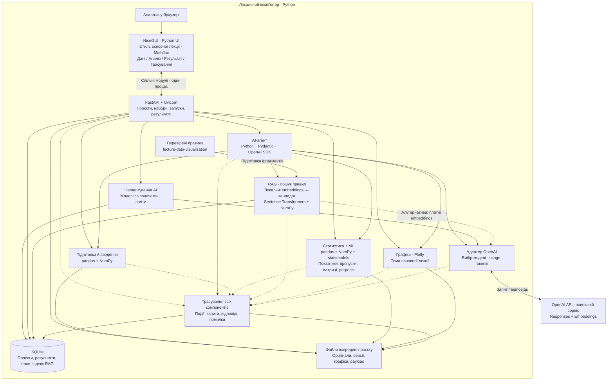

# Архітектура MVP — пропозиція 0.3

Дата: 2026-10-10 (Europe/Kiev). Підстава: [специфікація](specification.md), рішення автора й уточнення в записах 012–013 [історії](../PROJECT_HISTORY.md).

Підтверджено автором: локальний запуск, Python, зовнішній OpenAI, мінімальний зрозумілий UI з окремими функціями, зручний перегляд запитів і відповідей компонентів, визначення результату як MVP. FastAPI запропоновано автором як можливий засіб для ML; остаточний стек ще не затверджено. Інтеграція через OpenAI API — технічна пропозиція агента; модель та спосіб доступу ще не обрано.

## Схема

Стрілки позначають взаємодію й доступ, а не окремий мережевий сервіс для кожного блока. Уточнення 015: один локальний процес NiceGUI із FastAPI; попередню пропозицію двох процесів переглянуто для простого запуску. Агент, статистика, ML, RAG, графіки й трасування — модулі backend. SQLite — файл БД. Єдиний запропонований зовнішній сервіс — OpenAI. UI й API користуються спільними модулями; логіку обчислень не дублювати. Браузерний екран проєктів погоджено як наступну ітерацію; інші технології ще не затверджені.

## Технології та відповідальність

Уточнення автора, історія 013: налаштування моделей за задачами, захищене зберігання ключа та облік фактичних токенів без грошового обліку. Детальний контракт, кандидати моделей і сховище ключа — [ai-settings.md](ai-settings.md). Адаптер і router — модулі backend, не нові сервіси. Системне сховище ключа поза репозиторієм пропонується лише після дозволу автора.

| Частина | Пропонована технологія | Для чого / зв’язок зі специфікацією |
| --- | --- | --- |
| UI | NiceGUI + CSS у стилі дашборда автора (018) | Проєкти, завантаження, діалог, результат, trace; F-01–02, F-06, F-13–15 |
| API | FastAPI, Uvicorn, Pydantic | Єдина точка доступу до функцій, перевірка параметрів, контракт UI; F-01–14 |
| UI → ядро | Прямі виклики спільних модулів | Один процес; HTTPX між UI й API не потрібний; ключ не повертається браузеру |
| Агент | Python, OpenAI Python SDK, Responses API | Обмежений цикл виклику погоджених інструментів; F-05–06 |
| Модель | OpenAI, конкретна модель відкрита | Мета, план, виклики інструментів, пояснення; вибрати за якістю, доступом і бюджетом |
| RAG | Sentence Transformers, NumPy, SQLite — кандидат | Локальні embeddings і пошук; OpenAI embeddings як альтернатива; F-07, обговорення 014 |
| Дані | pandas, NumPy | Читання таблиць, якість, перетворення й з’єднання; F-02–04, F-09 |
| Статистика + ML | pandas, NumPy, statsmodels OLS | Описова статистика, пропуски, матриці теплових карт, регресія; F-09–10 |
| Графіки | Plotly, компонент графіка NiceGUI | Побудова в backend, відображення в UI; F-11 |
| Тема | Адаптація lecture.py | Основні правила й оформлення з SRC-004; код спочатку перевірити |
| Формули | MathJax, локальні JS-файли | Вибір автора; рівняння й показники, динамічний перерендер; F-12 |
| Збереження | SQLite через стандартний sqlite3 | Проєкти, описи, версії, запуски, зв’язки результатів, trace; F-08, F-14–15 |
| Файли | pathlib, JSON, вихідні табличні файли | Оригінали, похідні набори, результати та докладні payload; формат таблиць узгодити |
| Трасування | Власні структуровані події + SQLite; Python logging для технічних повідомлень | Пошук і перегляд фактичних дій; F-15 |
| Локальне середовище | Python venv, pip, узгоджені залежності | Відтворюваний запуск; версії фіксувати під час реалізації |
| Перевірки | pytest; контрольні дані й ручна перевірка UI | Аналіз, ізоляція проєктів, RAG, помилки та повнота trace |

Можливості бібліотек перевірено за офіційною документацією в [notes/technology-sources.md](../notes/technology-sources.md). Ця перевірка не підтверджує працездатність їхньої інтеграції в нашому MVP.

### Важливі деталі реалізації

Уточнення автора: «Статистика + ML» готує описові показники, аналіз пропусків та матриці теплових карт; модуль графіків їх відображає. Для матриці зберігати підписи, метод, одиниці й відомості про використані дані. Пропуски та кореляції — кандидати типів теплових карт, не затверджений повний каталог.

- Обчислення виконує backend, незалежно від агента: користувач може явно запустити перевірку даних або регресію кнопкою. Агент користується тими самими функціями.
- Доступ до наборів визначається `project_id` та версією. Агент отримує вузькі функції: огляд, перевірка, з’єднання, розрахунок, регресія, графік, пошук правила. Довільного виконання згенерованого Python чи SQL у запропонованому мінімумі немає.
- RAG індексує підготовлені й перевірені текстові правила, не весь чужий код автоматично. Фрагмент має джерело, розділ, версію й пріоритет. Embeddings зберігаються локально з назвою моделі та розмірністю; при її зміні індекс перебудовується. Для малого погодженого корпусу пропонується точний пошук NumPy без окремої векторної БД; придатність перевірити на фактичному обсязі.
- OpenAI отримує лише контекст, потрібний виклику: мету, метадані, результати обчислень та релевантні правила. Потребу передавати рядки даних визначити на демонстраційному наборі. Локальний запуск не означає повністю автономну роботу без інтернету.
- Наявна тема `lecture.py` імпортує seaborn, але для Plotly можна адаптувати лише її Plotly-частину й палітру. Тоді matplotlib/seaborn не є обов’язковими прямими залежностями MVP. R-тема — джерело порівняння, R-runtime у цей варіант не входить.
- UI не підміняє тему Plotly стандартним оформленням бібліотеки. Шрифт і повноту перенесення стилю перевірити в браузері. SVG-функції презентації не підключаються до Python автоматично; їх можна використати як зразки логіки й вигляду.
- Події UI запускають дії явно. Повторне відкриття екрана не повторює платних запитів; результат пов’язаний із run_id і зберігається backend. Сесійний стан UI не замінює БД.
- Для MVP пропонується один активний аналітичний запуск. UI отримує стан за `run_id`; обмежені задачі виконуються керованим локальним виконавцем backend. Тяжкі обчислення не блокують цикл HTTP-сервера. При перезапуску незавершений запуск позначається перерваним; автоматичного відновлення не обіцяємо. Вибір thread/process виконання й ліміти — після даних.
- Єдиний сервер слухає 127.0.0.1; сценарій публічного доступу й облікові записи не входять у цю пропозицію. Майбутній запуск, кеші й тимчасові файли — всередині репозиторію; ключ у захищеному сховищі Windows після погодження винятку або лише на час сесії; секрети не зберігаються в репозиторії, SQLite чи логах.

## UI: порівняння й рекомендація

Наведена оцінка — висновок агента для локального Python MVP, а не універсальний рейтинг.

| Варіант | Що добре для нас | Компроміс | Рекомендація |
| --- | --- | --- | --- |
| Streamlit + FastAPI | Python; готові завантаження, таблиці й графіки; швидке складання аналітичного інтерфейсу | Перезапуски UI потребують контролю стану; штатні формули використовують KaTeX; MathJax і точне оформлення потребують додаткової інтеграції | Початковий кандидат, переглянутий після вимог MathJax і стилю |
| NiceGUI + FastAPI | Python; подієві кнопки, картки, діалоги; власне CSS/HTML-оформлення | Більше власної роботи зі станом; підключення MathJax і тему перевірити прототипом | Поточна рекомендація для MVP |
| React + FastAPI | Більше контролю над навігацією, взаємодіями й переглядом trace | JavaScript/TypeScript, окрема збірка й додаткова розробка UI | Кандидат для наступного етапу, якщо Python UI стане обмеженням |

FastAPI — серверні функції, а не готовий аналітичний інтерфейс. У поточній схемі один backend для всіх функцій; розділення дозволяє змінити UI без переписування розрахунків, UI і API працюють в одному процесі. Після вибору автором MathJax та лекційного стилю рекомендацію переглянуто зі Streamlit на NiceGUI. Автор погодив браузерний екран NiceGUI + FastAPI як наступну ітерацію проєктів (015).

## Простий інтерфейс

**Оновлення 018:** дизайн UI тепер за дашбордом автора «Keeping the Lights On» (D-19, D-20; деталі — `src/data_story/assets/style.css`, `icons.py`). Абзац нижче описує попередній лекційний варіант і зберігається як історія; для графіків тема лекції лишається актуальною.

Дизайн — за основною лекцією, як указав автор. Прочитано engine.css: заголовки Montserrat, текст Open Sans, код JetBrains Mono; фон #FAFAF7, картки #F1F0EB, текст #3E4247, акцент #1B4F8A, попередження #C0504D. Вихідні розміри: h1 84px, h2 46px, h3 30px, основний текст 28px на слайді 1600×900. Їх адаптувати для UI зі збереженням ієрархії, а не механічно копіювати слайдовий масштаб. Іконки брати з основного джерела після уточнення конкретних файлів; випадковий новий набір не обирати. MathJax і ресурси стилю пропонується розмістити локально в проєкті, версії зафіксувати під час реалізації.

Постійно видно поточний проєкт. Навігація: «Дані», «Дослідження», «Результат», «Трасування». На кожному кроці — коротка задача й одна основна дія: завантажити, перевірити, зіставити, обрати питання, проаналізувати, побудувати регресію або переглянути результат. Це послідовні підекрани/вкладки, не великий dashboard.

Пропозиція деталізації вимоги автора: один основний графік у перегляді; інші результати відкриваються зі списку. Для порівняння — окремий режим, якщо він потрібний задачі. Технічні подробиці не показуються в кожному екрані; кнопка «Переглянути дії» відкриває відповідний trace.

## Трасування: запит → компонент → відповідь

Авторська вимога: логувати дії компонентів і зручно переглядати фактичні запити та відповіді. Пропозиція реалізації:

1. Кожна дія має `trace_id`, запуск — `run_id`, крок — `span_id` та посилання на батьківський крок. Ці ID проходять через UI, API, агента, RAG, ML, графіки й сховище.
2. Запис кроку: проєкт, час, компонент, операція, стан, тривалість, параметри/запит, відповідь, помилка, версія даних і посилання на результат. Для OpenAI — також модель, фактичні доступні request/response ID, використання токенів і номер спроби.
3. Записуються старт і завершення виклику; помилка не зникає за успішним повтором. Для повного обліку спроб керовані повтори виконуються на рівні нашого адаптера, а не залишаються невидимими всередині SDK.
4. Журнал бізнес-дій зберігається в SQLite; великі payload — в локальних файлах з посиланням. Це дозволяє переглядати минулі запуски після перезапуску.
5. Облікові ключі, Authorization-заголовки й секрети маскуються до збереження. Для великих таблиць і векторів показується короткий огляд із переходом до збереженого payload або точного артефакту/версії; скорочення й маскування явно позначені. Політику зберігання персональних полів узгодити до використання реальних даних.
6. Екран trace: фільтри за проєктом, запуском, компонентом, датою й помилкою; список кроків у часі та вкладені виклики. При відкритті кроку — вкладки «Запит», «Відповідь», «Помилка», «Результат», форматований JSON і читабельний текст.
7. Пропозиція додаткової зручності: пошук по повідомленнях і експорт очищеного trace JSON. Експорт ще не затверджено.

Окремий контрольний сценарій трасування: запит користувача → знайдені RAG-фрагменти → запит OpenAI → виклик інструмента → дані й обчислення → графік → остаточна відповідь. За помилки інструмента має бути видно вхід, помилку й відповідну реакцію агента. Трасування охоплює спостережувані взаємодії, не обіцяє внутрішнього процесу мислення моделі.

У першій схемі зовнішні Langfuse, OpenTelemetry collector, Redis, Celery, окремі векторна БД і ML-сервіс не потрібні. За іншого масштабу або вимог їх розглядатимемо окремо; рішення про відмову від них назавжди не прийнято.

Додаткові компоненти F-16–17: конфігурація моделей і лімітів у SQLite, адаптер OpenAI для вибору моделі та обліку фактичного usage, Python keyring із Windows Credential Manager для ключа після дозволу на зовнішнє сховище. Перегляд токенів інтегрований у trace; грошовий облік не включено.

## Назва та відкриті рішення

Автор визначив результат як MVP і запропонував назву **Data Story**. Вона передає перехід від даних до зрозумілої історії; це оцінка агента. Пропозиція підпису агента: «AI-помічник для дослідження та візуалізації даних». Остаточне затвердження назви й підпису ще не отримано; доступність бренду чи домену не перевірено. Раніше агент запропонував «ДаніДоДії», «СенсДаних» та «DataWeave»; ці альтернативи не обрано.

Перед реалізацією визначити: UI, остаточну згоду на FastAPI, модель і доступ до OpenAI API, демонстраційні дані, формати, інструменти першого сценарію, правила збереження payload. Зараз підготовлено схему й технологічну пропозицію; нічого не встановлено, сервери й API-виклики не запускалися.
