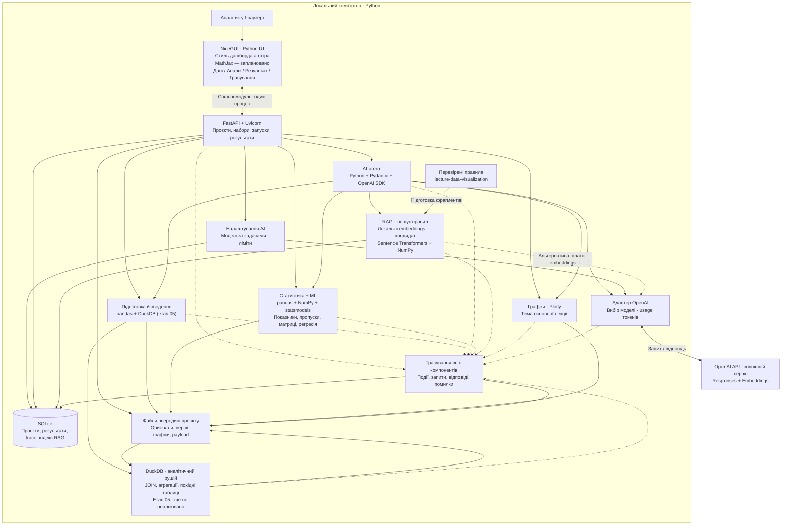

# Архітектура MVP — редакція 0.4

**Актуальний стан (2026-10-12, історія 111):** цей документ зберігає історичну пропозицію 026. Перебудова DuckDB, розділення двох входів AI, поточні зв’язки й перевірки — [architecture-next.md](architecture-next.md). Не трактувати застарілі позначки «заплановано» нижче як актуальний список відсутніх функцій.

Оновлено: 2026-10-10 (Europe/Kiev), історія 026. Підстава: [специфікація](specification.md), [рішення автора](decisions.md), історії 012–026.

**Реалізовано:** Python 3.13, NiceGUI + FastAPI в одному процесі, SQLite (схема v5), pandas/openpyxl; проєкти, дані й метадані. Етап 01 прийнято; 02/02b чекають формального приймання. UI — дашборд зі стилем і логотипом автора. Назва продукту — Data Story (поточне звернення автора, історія 026).

**Заплановано:** DuckDB для підготовки й зведення даних (етап 05); статистика, ML, графіки, MathJax, RAG, налаштування OpenAI та агент ще не реалізовані. DuckDB додано в архітектуру за дорученням автора; залежність, формат похідних даних і контракт обчислень визначимо під час реалізації відповідного компонента. Решта кандидатів технологій нижче не стає автоматично погодженим стеком. Етап 03 потребує окремої згоди автора.

## Схема

Схема поєднує реалізовані й майбутні компоненти; поточний стан визначено вище. Один локальний процес NiceGUI із FastAPI; UI й API викликають спільний сервіс. Статистика, ML, RAG, DuckDB та агент — модулі backend, без окремих серверів. SQLite зберігає стан застосунку; DuckDB виконує табличні обчислення. OpenAI — запланований зовнішній сервіс.

## Технології та відповідальність

Уточнення автора, історія 013: налаштування моделей за задачами, захищене зберігання ключа та облік фактичних токенів без грошового обліку. Детальний контракт, кандидати моделей і сховище ключа — [ai-settings.md](ai-settings.md). Адаптер і router — модулі backend, не нові сервіси. Системне сховище ключа поза репозиторієм пропонується лише після дозволу автора.

| Частина | Технологія / стан | Для чого / зв’язок зі специфікацією |
| --- | --- | --- |
| UI | NiceGUI + CSS у стилі дашборда автора (018) | Проєкти, завантаження, діалог, результат, trace; F-01–02, F-06, F-13–15 |
| API | FastAPI, Uvicorn, Pydantic | Єдина точка доступу до функцій, перевірка параметрів, контракт UI; F-01–14 |
| UI → ядро | Прямі виклики спільних модулів | Один процес; HTTPX між UI й API не потрібний; ключ не повертається браузеру |
| Агент | Python, OpenAI Python SDK, Responses API | Обмежений цикл виклику погоджених інструментів; F-05–06 |
| Модель | OpenAI, конкретна модель відкрита | Мета, план, виклики інструментів, пояснення; вибрати за якістю, доступом і бюджетом |
| RAG | Sentence Transformers, NumPy, SQLite — кандидат | Локальні embeddings і пошук; OpenAI embeddings як альтернатива; F-07, обговорення 014 |
| Дані | pandas/openpyxl — реалізовано; NumPy — для майбутніх розрахунків | Читання таблиць і профіль; майбутні перетворення; F-02–04, F-09 |
| Аналітичні запити | DuckDB — заплановано на етапі 05 | З’єднання, фільтрація, групування й агрегації над наборами поточного проєкту; F-03–04 |
| Статистика + ML | pandas, NumPy, statsmodels OLS | Описова статистика, пропуски, матриці теплових карт, регресія; F-09–10 |
| Графіки | Plotly, компонент графіка NiceGUI | Побудова в backend, відображення в UI; F-11 |
| Тема | Адаптація lecture.py | Основні правила й оформлення з SRC-004; код спочатку перевірити |
| Формули | MathJax, локальні JS-файли | Вибір автора; рівняння й показники, динамічний перерендер; F-12 |
| Збереження | SQLite через стандартний sqlite3 — реалізовано, схема v5 | Проєкти, описи, версії, запуски, зв’язки результатів, trace; F-08, F-14–15 |
| Файли | pathlib, JSON, вихідні табличні файли | Оригінали, похідні набори, результати та докладні payload; формат таблиць узгодити |
| Трасування | Власні структуровані події + SQLite; Python logging для технічних повідомлень | Пошук і перегляд фактичних дій; F-15 |
| Локальне середовище | Python venv, pip, узгоджені залежності | Відтворюваний запуск; версії фіксувати під час реалізації |
| Перевірки | pytest; контрольні дані й ручна перевірка UI | Аналіз, ізоляція проєктів, RAG, помилки та повнота trace |

Можливості бібліотек перевірено за офіційною документацією в [notes/technology-sources.md](../notes/technology-sources.md). Ця перевірка не підтверджує працездатність їхньої інтеграції в нашому MVP.

### SQLite, DuckDB та pandas

Розподіл відповідальності для нашого MVP:

| Компонент | Роль | Стан |
| --- | --- | --- |
| SQLite | Проєкти, реєстр наборів, JSON-метадані, інструкції та журнал; надалі — посилання на версії й результати | Уже працює, схема v4 |
| pandas/openpyxl | Поточний імпорт CSV/XLSX, профіль і огляд; підготовка таблиць для статистики та ML | Уже працює |
| DuckDB | SQL-з’єднання наборів, фільтрація, групування, агрегації й підготовка похідної таблиці | Етап 05, реалізацію ще не почато |
| Файли в `runtime/projects/<project_id>/` | Оригінали; надалі — похідні версії та результати | Оригінали вже зберігаються; формат похідних версій відкритий |

DuckDB має Python API, SQL над pandas DataFrame та повернення результату в DataFrame; можна працювати в пам’яті або з файлом БД. Це перевірено за [офіційною документацією Python API](https://duckdb.org/docs/current/clients/python/overview) і [SQL on Pandas](https://duckdb.org/docs/current/guides/python/sql_on_pandas), а не запуском інтеграції в MVP.

Пропозиція потоку для етапу 05: користувач вибирає набори свого проєкту → сервіс перевіряє ID, версії, типи й ключі → реєструє підготовлені таблиці pandas у з’єднанні DuckDB → виконує погоджену операцію → перевіряє дублікати ключів, кількість зіставлень і рядків → зберігає нову версію та її походження в реєстрі SQLite. Оригінали зберігаються. XLSX спочатку читається наявним openpyxl/pandas; пряме читання Excel через розширення DuckDB не закладено в цей план. Parquet — кандидат для похідних таблиць, ще не погоджений формат.

Для етапу 03 не переносимо поточне читання даних у DuckDB: описові показники, пропуски й кореляції плануються через pandas. Після появи підсистеми 05 її результати передаються тим самим статистичним і ML-функціям. На етапі 09 агент зможе викликати перевірені операції підсистеми 05; довільний SQL від моделі в обсяг цієї зміни не входить.

Технічні деталі нижче — пропозиція реалізації, яку потрібно перевірити на етапі 05: окреме з’єднання DuckDB для задачі, явне закриття, ліміти пам’яті й часу, тимчасові файли в `tmp/`, можливі файли БД у `runtime/` поточного проєкту. Фіксувати в журналі операцію, параметри, вхідні версії, результат і помилки. До додавання залежності перевірити Python 3.13/Windows, ізоляцію двох проєктів, збіг контрольних розрахунків і поведінку після перезапуску. Версію пакета зафіксувати в `requirements.lock` тоді, коли він стане потрібним.

### Важливі деталі реалізації

Уточнення автора: «Статистика + ML» готує описові показники, аналіз пропусків та матриці теплових карт; модуль графіків їх відображає. Для матриці зберігати підписи, метод, одиниці й відомості про використані дані. Пропуски та кореляції — кандидати типів теплових карт, не затверджений повний каталог.

- Обчислення виконує backend, незалежно від агента: користувач може явно запустити перевірку даних або регресію кнопкою. Агент користується тими самими функціями.
- Доступ до наборів визначається `project_id` та версією. Агент отримує вузькі функції: огляд, перевірка, з’єднання, розрахунок, регресія, графік, пошук правила. Довільного виконання згенерованого Python чи SQL у запропонованому мінімумі немає.
- RAG індексує підготовлені й перевірені текстові правила, не весь чужий код автоматично. Фрагмент має джерело, розділ, версію й пріоритет. Embeddings зберігаються локально з назвою моделі та розмірністю; при її зміні індекс перебудовується. Для малого погодженого корпусу пропонується точний пошук NumPy без окремої векторної БД; придатність перевірити на фактичному обсязі.
- OpenAI отримує лише контекст, потрібний виклику: мету, метадані, результати обчислень та релевантні правила. Потребу передавати рядки даних визначити на демонстраційному наборі. Локальний запуск не означає повністю автономну роботу без інтернету.
- Наявна тема `lecture.py` імпортує seaborn, але для Plotly можна адаптувати лише її Plotly-частину й палітру. Тоді matplotlib/seaborn не є обов’язковими прямими залежностями MVP. R-тема — джерело порівняння, R-runtime у цей варіант не входить.
- UI не підміняє тему Plotly стандартним оформленням бібліотеки. Шрифт і повноту перенесення стилю перевірити в браузері. SVG-функції презентації не підключаються до Python автоматично; їх можна використати як зразки логіки й вигляду.
- Події UI запускають дії явно. Повторне відкриття екрана не повторює платних запитів; результат пов’язаний із run_id і зберігається backend. Сесійний стан UI не замінює БД.
- Для MVP пропонується один активний аналітичний запуск. UI отримує стан за `run_id`; обмежені задачі виконуються керованим локальним виконавцем backend. Тяжкі обчислення не блокують цикл HTTP-сервера. При перезапуску незавершений запуск позначається перерваним; автоматичного відновлення не обіцяємо. Вибір thread/process виконання й ліміти — після даних.
- Єдиний сервер слухає 127.0.0.1; сценарій публічного доступу й облікові записи не входять у цю пропозицію. Майбутній запуск, кеші й тимчасові файли — всередині репозиторію; ключ у захищеному сховищі Windows після погодження винятку або лише на час сесії; секрети не зберігаються в репозиторії, SQLite чи логах.

## UI: порівняння й рекомендація

Наведена оцінка — висновок агента для локального Python MVP, а не універсальний рейтинг.

| Варіант | Що добре для нас | Компроміс | Рекомендація |
| --- | --- | --- | --- |
| Streamlit + FastAPI | Python; готові завантаження, таблиці й графіки; швидке складання аналітичного інтерфейсу | Перезапуски UI потребують контролю стану; штатні формули використовують KaTeX; MathJax і точне оформлення потребують додаткової інтеграції | Початковий кандидат, переглянутий після вимог MathJax і стилю |
| NiceGUI + FastAPI | Python; подієві кнопки, картки, діалоги; власне CSS/HTML-оформлення | Більше власної роботи зі станом; підключення MathJax і тему перевірити прототипом | Реалізовано для етапів 01–02b |
| React + FastAPI | Більше контролю над навігацією, взаємодіями й переглядом trace | JavaScript/TypeScript, окрема збірка й додаткова розробка UI | Кандидат для наступного етапу, якщо Python UI стане обмеженням |

FastAPI — серверні функції, а не готовий аналітичний інтерфейс. У поточній схемі один backend для всіх функцій; розділення дозволяє змінити UI без переписування розрахунків, UI і API працюють в одному процесі. Після вибору автором MathJax та лекційного стилю рекомендацію переглянуто зі Streamlit на NiceGUI. Автор погодив браузерний екран NiceGUI + FastAPI як наступну ітерацію проєктів (015).

## Простий інтерфейс

Інтерфейс — дашборд за зразком автора «Keeping the Lights On» (D-19, D-20). Ліва панель на всю висоту з фінальним логотипом; праворуч тонка смуга з навігаційним ланцюжком і робоча область. Суцільний список меню; згорнутий стан показує знак та іконки й запам’ятовується. Без заокруглень, тіней і карток-рамок.

Шрифти: IBM Plex Sans для тексту, STIX Two Text для заголовків і виділень, обидва з кирилицею. Акцент `#174690`, текст `#262626`/`#5F5F5F`, лінії `#EBEBEB`, тло виділення `#F3F4F6`, попередження `#C0392B`. Іконки — лінійні SVG 24×24, єдине джерело `src/data_story/icons.py`. Верстка — `screen.py` і `assets/style.css`; фінальний логотип — `design/logo/final/`. Дизайн чекає відгуку автора; ця ітерація його не змінює.

Поточний проєкт видно в навігації. Кожна функція має простий окремий екран. Для майбутніх графіків і формул джерело — основна лекція, MathJax обрано автором. Пропозиція для перегляду результатів: один основний графік, інші зі списку; окремий перегляд дій компонентів. Ці майбутні екрани ще не реалізовані.

## Трасування: запит → компонент → відповідь

Авторська вимога: логувати дії компонентів і зручно переглядати фактичні запити та відповіді. Пропозиція реалізації:

1. Кожна дія має `trace_id`, запуск — `run_id`, крок — `span_id` та посилання на батьківський крок. Ці ID проходять через UI, API, агента, RAG, ML, графіки й сховище.
2. Запис кроку: проєкт, час, компонент, операція, стан, тривалість, параметри/запит, відповідь, помилка, версія даних і посилання на результат. Для OpenAI — також модель, фактичні доступні request/response ID, використання токенів і номер спроби.
3. Записуються старт і завершення виклику; помилка не зникає за успішним повтором. Для повного обліку спроб керовані повтори виконуються на рівні нашого адаптера, а не залишаються невидимими всередині SDK.
4. Журнал бізнес-дій зберігається в SQLite; великі payload — в локальних файлах з посиланням. Це дозволяє переглядати минулі запуски після перезапуску.
5. Облікові ключі, Authorization-заголовки й секрети маскуються до збереження. Для великих таблиць і векторів показується короткий огляд із переходом до збереженого payload або точного артефакту/версії; скорочення й маскування явно позначені. Політику зберігання персональних полів узгодити до використання реальних даних.
6. Екран trace: фільтри за проєктом, запуском, компонентом, датою й помилкою; список кроків у часі та вкладені виклики. При відкритті кроку — вкладки «Запит», «Відповідь», «Помилка», «Результат», форматований JSON і читабельний текст.
7. Пропозиція додаткової зручності: пошук по повідомленнях і експорт очищеного trace JSON. Експорт ще не затверджено.

Окремий контрольний сценарій трасування: запит користувача → знайдені RAG-фрагменти → запит OpenAI → виклик інструмента → дані й обчислення → графік → остаточна відповідь. За помилки інструмента має бути видно вхід, помилку й відповідну реакцію агента. Трасування охоплює спостережувані взаємодії, не обіцяє внутрішнього процесу мислення моделі.

У першій схемі зовнішні Langfuse, OpenTelemetry collector, Redis, Celery, окремі векторна БД і ML-сервіс не потрібні. За іншого масштабу або вимог їх розглядатимемо окремо; рішення про відмову від них назавжди не прийнято.

Додаткові компоненти F-16–17: конфігурація моделей і лімітів у SQLite, адаптер OpenAI для вибору моделі та обліку фактичного usage, Python keyring із Windows Credential Manager для ключа після дозволу на зовнішнє сховище. Перегляд токенів інтегрований у trace; грошовий облік не включено.

## Назва та відкриті рішення

Назва поточного MVP — **Data Story**; фінальний логотип і слоган автора «AI powered analytics & storytelling» уже в інтерфейсі. Попередні альтернативи зберігаються в історії; доступність бренду чи домену не перевіряли.

Відкрито: формальне приймання 02/02b і відгук щодо дизайну; підтвердження тимчасових форматів та ліміту D-25; справжній демонстраційний набір; конкретні моделі OpenAI й сховище ключа; корпус і модель RAG; перелік графіків, формат підсумку й похідних таблиць; вимоги курсу до здачі. Етап 03 — тільки після згоди автора. Архітектурні пропозиції майбутніх компонентів не є підтвердженням їхньої реалізації.

## Майбутнє формування звітів — історія 027

Автор погодив окремий етап 10 генерації звітів і запропонував розглянути Quarto. Пропозиція потоку: збережені результати статистики/ML, графіки й пояснення → Markdown-чернетка → правки користувача → сервіс формування → локальний документ. Для Quarto сервіс готує `.qmd` із керованим шаблоном і запускає локальний інструмент; Python API/CLI-спосіб інтеграції й розміщення ресурсів ще перевірити. SQLite зберігатиме реєстр і посилання на версії звіту; файли — тексти, ресурси й готові документи.

HTML першим, PDF/DOCX після окремого вибору — пропозиція агента. MathJax застосовний до HTML; PDF через LaTeX має інший механізм формул і додатковий TeX-дистрибутив. Стиль графіків з основної лекції зберігається; шаблон звіту ще погодити. Не повторювати аналіз або платні AI-виклики автоматично під час формування. Quarto не встановлено й не перевірено в MVP. Контракт та критерії — у `planning/plan.md`.

## Реалізований Markdown-редактор — історія 028

У конфігурації інструкцій — TOAST UI Editor 3.2.2 через власний Vue-компонент NiceGUI (`markdown_editor.py`, `assets/markdown_editor.js`). Редагування Markdown з українськими підказками, короткою довідкою та опційним переглядом. При збереженні UI читає актуальний Markdown і передає його чинному сервісу конфігурації; SQLite й API-контракт не змінені. Локальні JS/CSS/локалізація, usage tracking вимкнено; браузерний сценарій пройшов із блокуванням зовнішніх HTTP-запитів. Візуальний режим редагування приховано. Редактор майбутніх звітів можна будувати на цьому компоненті після погодження їхнього контракту; Quarto ще не інтегровано.
